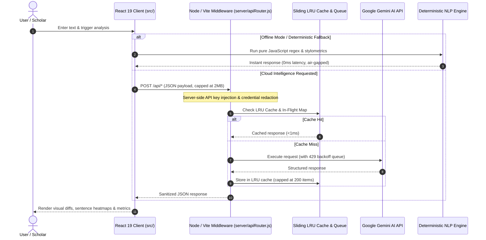

<p align="center">
  <picture>
    <source media="(prefers-color-scheme: dark)" srcset="public/logo-dark.png">
    <source media="(prefers-color-scheme: light)" srcset="public/logo-light.png">
    
  </picture>
</p>

<h1 align="center">Lexora AI Intelligence Suite</h1>

<p align="center">
  <strong>The Art of Better Words.</strong><br>
  A research-grounded, production-grade linguistic intelligence suite combining editorial writing tools, multi-model AI text detection, scholarly academic unslop refinement, and empirical detector benchmarking.
</p>

<p align="center">
  <a href="LICENSE"></a>
  <a href="https://react.dev/"></a>
  <a href="https://vite.dev/"></a>
  <a href="https://tailwindcss.com/"></a>
  <a href="https://oxc.rs/"></a>
  <a href="#-verification--automated-testing"></a>
  <a href="https://nodejs.org/"></a>
</p>

<p align="center">
  <a href="#-overview">Overview</a> •
  <a href="#-core-modules">Core Modules</a> •
  <a href="#-architecture--engineering-highlights">Architecture</a> •
  <a href="#-quickstart">Quickstart</a> •
  <a href="#-environment-configuration">Configuration</a> •
  <a href="#-verification--automated-testing">Testing</a> •
  <a href="#-repository-structure">Structure</a> •
  <a href="#-deployment">Deployment</a> •
  <a href="#-responsible-ai--methodological-disclosures">Ethical Disclosures</a> •
  <a href="#-license">License</a>
</p>

---

## 📖 Overview

**Lexora** is an open-source, ethical linguistic analysis and writing platform designed for researchers, authors, students, and engineers.

Most consumer writing tools either act as opaque generative text spinners or promote adversarial "AI humanizer" bypasses. Lexora takes a transparent, verifiable approach:
* **Decoupled & Non-Adversarial:** The editing and detection pipelines are strictly isolated to eliminate adversarial exploitation loops.
* **Deterministic Offline Resilience:** Every capability—from grammar correction to stylometric analysis—is backed by deterministic local rules that function seamlessly without cloud API keys or network access.
* **Citation & Empirical Safeguards:** Academic transformations utilize isolated placeholder masking to guarantee 100% preservation of bracketed references, DOIs, and statistical notations.
* **Empirical Transparency:** Rather than producing misleading binary scores, the AI Checker surfaces sentence-level perplexity heatmaps and cross-detector agreement metrics (Cohen's Kappa).

---

## 🌟 Core Modules

```
┌─────────────────────────────────────────────────────────────────────────────┐
│                         LEXORA INTELLIGENCE SUITE                           │
├───────────────────┬───────────────────┬───────────────────┬─────────────────┤
│ ✍️ Writing Studio │  🛡️ AI Checker    │ 🎓 Academic       │ 🔬 Research Lab │
│                   │                   │    Refiner        │                 │
│ • 7 AI rewrite    │ • Free Gemini     │ • Nature-standard │ • ROC-AUC & F1  │
│   transformations │   Neural Detector │   unslop engine   │   metrics       │
│ • Contextual Word │ • Local offline   │ • 100% citation & │ • Labeled test  │
│   Enhancer        │   stylometrics    │   DOI safeguard   │   corpus        │
│ • Backward slice  │ • Perplexity &    │ • Decoupled,      │ • Robustness    │
│   diff engine     │   burstiness maps │   non-adversarial │   benchmarks    │
└───────────────────┴───────────────────┴───────────────────┴─────────────────┘
```

### 1. ✍️ Writing Studio (`#studio`)
* **Interactive Proofreading Canvas & Real-Time Span Analysis:**
  * **Color-Coded Diagnostic Highlights:** Underlines detected grammar, spelling, clarity, punctuation, and style issues with non-overlapping visual marks.
  * **Accessible Suggestion Popover:** Click or keyboard-navigate (`Enter`/`Space`) to inspect explanations and apply immediate one-click replacements.
  * **Document Health Inspector:** Displays categorized issues by category (*Grammar*, *Spelling*, *Clarity*, *Punctuation*, *Style*), dynamic document health score, and single-click **Accept All** batch correction.
  * **Honest Scanning Lifecycle:** Clear distinction between *Empty Draft*, *Checking Draft…*, *Unchecked Draft*, *Issues Found*, and verified *All Clear · No Issues*. Never displays false 100% scores on unscanned text.
* **7 Focused Transformations:**
  * **Grammar & Spelling:** Corrects orthographic, grammatical, and typographical issues.
  * **Sentence Rephrase:** Reconstructs awkward syntax for natural sentence flow.
  * **Fluency:** Standardizes idioms and phrasing for non-native English writing.
  * **Shorten:** Eliminates wordiness and deadwood while preserving core semantics.
  * **Simplify:** Translates convoluted vocabulary into accessible phrasing.
  * **Professional Tone:** Polishes casual drafts for business and workplace communications.
  * **Casual Tone:** Relaxes rigid prose into conversational language.
* **Contextual Word Enhancer:** High-precision synonym thesaurus grouped across *Professional*, *Casual*, *Stronger*, and *Simpler* registers.
* **Backward Slice Diff Engine:** Computes character- and token-level visual diffs applied backwards by index, preventing substring span shifting and replacement collisions.

### 2. 🛡️ AI Text Checker (`#ai-checker`)
* **Dual Free Default Detectors:**
  * **Lexora Neural AI Detector (Free):** Evaluates linguistic cadence and perplexity via Google Gemini (`gemini-3.5-flash`, `gemini-3.5-flash-lite`, `gemini-3.8-flash`) with multi-model fallback.
  * **Lexora Local Stylometrics Engine (Free & Offline):** Pure JavaScript statistical NLP analyzer that evaluates sentence length variance (burstiness index), type-token lexical diversity (TTR), and character n-gram distribution without API keys.
* **Sentence-Level Perplexity Heatmap:** Color-coded sentence breakdown (*Human*, *Mixed*, *AI*) with per-sentence metrics on hover.
* **Multi-Provider Cross-Verification:** Optional integrations for commercial providers ([GPTZero](https://docs.gptzero.me/), [Copyleaks](https://docs.copyleaks.com/)) with automated Cohen's Kappa inter-detector agreement calculation.
* **Four-Tier Provenance Classification:** Classifies text into `human-written`, `human-written & ai-refined`, `ai-generated & ai-refined`, and `ai-generated`.
* **Outdated Result Detection:** Automatically flags scan results as `[Outdated Result]` when the draft is modified after scanning, preventing stale evaluation.

### 3. 🎓 Academic Refiner (`#academic-refiner`)
* **Nature-Standard Unslop Engine:** Purges formulaic LLM stock tropes (*"delve into"*, *"intricate tapestry"*, *"plays a pivotal role"*, *"testament to"*, *"underscores the importance"*, *"sheds light on"*, *"groundbreaking"*).
* **Guaranteed Citation Protection:** Tokenizes references into protected placeholders `[[REF_1]]` prior to processing, ensuring 100% preservation of bracketed citations `[1, 2]`, author-year formats `(Smith et al., 2023)`, DOIs, and empirical statistics ($p < 0.05$, $R^2$).
* **Scholarly Discourse Methods:** Automated contraction expansion, objective passive voice transformation, and academic discourse transition synthesis.

### 4. 🔬 Detector Research Lab (`#detector-lab`)
* **Empirical Ground-Truth Dataset:** Pre-loaded with curated research samples across human academic manuscripts, raw LLM outputs, and collaboratively revised texts.
* **Statistical Metrics Engine:** Computes Precision (PPV), Recall (Sensitivity), Specificity (TNR), F1 Score, False Positive Rate (FPR), False Negative Rate (FNR), and ROC-AUC.
* **Dynamic Decision Threshold Calibration ($\tau$):** Real-time interactive decision threshold slider to evaluate trade-offs between false positives and false negatives.
* **Peer-Reviewed Reference Base:** Grounded in research from NAACL 2025, Cambridge University Press (*Data & Policy 2025*), Springer (*Acta Neurochirurgica 2025*), and OpenAI's classifier methodology.

---

## 🏗️ Architecture & Engineering Highlights



### Key Technical Pillars
1. **Zero Client-Side Secrets:** Upstream credentials (`GEMINI_API_KEY`, `GPTZERO_API_KEY`, `COPYLEAKS_API_KEY`) reside exclusively in server-side environment variables. No credentials are prefixed with `VITE_` or exposed in client bundles.
2. **Payload Protection & Error Sanitization:** The server proxy enforces a strict 2MB maximum body ceiling with immediate stream termination (`HTTP 413`) to prevent memory exhaustion DoS attacks. Outbound error messages are sanitized to redact API keys and query strings.
3. **Resilient Rate-Limit & Caching Architecture:**
   * **Sliding-Window LRU Cache:** In-memory 200-item LRU cache eliminates redundant upstream requests.
   * **In-Flight Request Deduplication:** Merges identical concurrent queries into a single shared promise.
   * **Graceful 429 Backoff Queue:** Catches HTTP 429 quota exhaustion, serializes subsequent requests via an execution queue, and enforces automatic 20-second backoff.
4. **Optimized Route-Level Code Splitting:** Heavy PDF processing (`pdfjs-dist`) and secondary views are dynamically loaded with `React.lazy` and `Suspense`, keeping the initial bundle under 470 kB (141 kB gzip).
5. **Strict JavaScript + JSX Constraint:** Pure modern React 19 architecture with zero TypeScript compile-time overhead or build friction.

---

## 🛠️ Technology Stack

| Layer | Technology | Details |
| :--- | :--- | :--- |
| **Frontend Framework** | [React 19.3](https://react.dev/) | Functional components, hooks, concurrent rendering |
| **Build Tooling** | [Vite 8.3](https://vite.dev/) | Lightning-fast HMR and Rollup-based production bundling |
| **Styling & Design** | [Tailwind CSS v4.3](https://tailwindcss.com/) | CSS-first configuration, bespoke dark/light design system |
| **Icons & Motion** | [Lucide React](https://lucide.dev/) / [Framer Motion](https://www.framer.com/motion/) | Scalable accessible iconography and micro-animations |
| **Linter** | [Oxlint](https://oxc.rs/) | Rust-based high-performance JavaScript linter (0 errors, 0 warnings) |
| **Testing Harness** | [Vitest](https://vitest.dev/) / [Testing Library](https://testing-library.com/) | Unit, component, and regression testing with v8 coverage |
| **Document Parsing** | [PDF.js](https://mozilla.github.io/pdf.js/) (`pdfjs-dist`) | Lazy-loaded client-side PDF document text extraction |
| **Cloud Intelligence** | [Google Gemini API](https://ai.google.dev/) | `@google/genai` multi-model fallback (`3.5-flash`, `3.5-flash-lite`, `3.8-flash`) |

---

## 🚀 Quickstart

### Prerequisites
* **Node.js:** `v18.0.0` or higher (`v20.x` recommended LTS)
* **npm:** `v9.0.0` or higher

### Installation

```bash
# 1. Clone the repository
git clone https://github.com/SFRREX/lexora.git
cd lexora

# 2. Install dependencies (clean reproducible install)
npm ci
```

### Environment Configuration

Copy the sanitized environment template:

```bash
cp .env.example .env
```

Open `.env` to configure your keys:

```env
# Google Gemini API Key (Free at https://aistudio.google.com/)
GEMINI_API_KEY=your_gemini_api_key_here

# Optional Commercial Detectors (Leave blank to use Free Default Detectors)
GPTZERO_API_KEY=
COPYLEAKS_EMAIL=
COPYLEAKS_API_KEY=
```

> **Offline Note:** Lexora is fully functional **out of the box** without any API keys. When keys are unconfigured, it automatically utilizes its built-in Local Rules Engine and Local Stylometrics NLP analyzer.

### Local Development

Start the development server with local API proxy middleware:

```bash
npm run dev
```

Open [http://localhost:5173](http://localhost:5173) in your browser.

---

## 🧪 Verification & Automated Testing

Lexora features a comprehensive test harness covering component behavior, adapter normalization, offline statistical routines, and build integrity:

```bash
# Run full Vitest unit & component test suite (97 tests across 12 files)
npm test

# Run Vitest in interactive watch mode
npm run test:watch

# Generate code coverage report via v8 engine
npm run test:coverage

# Run integration & adapter verification suites
npm run test:suite

# Run Oxlint high-performance code linter
npm run lint

# Compile optimized production bundle
npm run build

# Run complete unified quality gate (lint + tests + integration + build)
npm run check
```

### Verified Test Suite Breakdown
* **`src/test/humanizerDetectorRegression.test.jsx` (14 tests):** Tests A–H regression suite (cross-view state handoff, manual edit invalidation, score normalization, request race conditions, honest detection results).
* **`src/test/academicRefiner.test.js` (9 tests):** Citation isolation, contraction expansion, passive voice restructuring, formal synonym replacement, and text metrics calculation.
* **`src/test/academicHumanizer.test.js` (6 tests):** Scholarly unslop, formulaic transition purging, and cadence variation.
* **`src/test/detectors.test.js` (9 tests):** Adapter normalization for GPTZero, Copyleaks, Local Stylometrics, and Gemini Neural Detector.
* **`src/test/researchMetrics.test.js` (3 tests):** Classification statistics (Precision, Recall, F1, FPR, FNR, ROC-AUC) and Cohen's Kappa agreement matrix.
* **`src/test/textRules.test.js` (16 tests):** Deterministic grammar correction, sentence shortening, tone adjustment, and repeated-word span extraction.
* **`src/test/theme.test.js` (5 tests):** Light/dark/system theme coordination, local storage synchronization, and OS preference listeners.
* **`src/test/components.test.jsx` (16 tests):** Component rendering and user interaction tests across `WritingEditor`, `WordEnhancer`, `ResultPanel`, `BeforeAfter`, `FinalCTA`, `Navbar`, and `Footer`.
* **`src/test/AcademicRefiner.test.jsx` (3 tests):** Intensity slider, preset buttons, and view handoff.
* **`src/test/GrammarInspector.test.jsx` (9 tests):** Health score calculation, empty draft state, in-flight scanning, unscanned draft state, category filtering, single and batch fixes.
* **`src/test/InteractiveCanvas.test.jsx` (3 tests):** Wavy underline rendering, popover opening, and correction application.
* **`src/test/grammarSpans.test.js` (4 tests):** Exact character span offset calculation, health score normalization, and overlap elimination.

---

## 📂 Repository Structure

```text
lexora/
├── .github/                      # GitHub automation & configuration
│   ├── dependabot.yml            # Automated weekly dependency updates
│   └── workflows/
│       └── ci.yml                # CI quality gate (lint, test, build, audit)
├── api/                          # Serverless entry points (Vercel / Edge)
│   ├── detectors/scan.js         # Multi-provider scan endpoint
│   ├── detectors/status.js       # Provider configuration check
│   ├── process-text.js           # Writing Studio text processing
│   ├── refine-academic.js        # Academic Refiner unslop pipeline
│   └── word-alternatives.js      # Contextual thesaurus lookup
├── e2e/                          # Playwright end-to-end verification
│   └── lexora.spec.js            # Cross-view integration tests
├── public/                       # Static public assets
│   ├── logo-light.png            # Official light-theme logo
│   ├── logo-dark.png             # Official dark-theme logo
│   ├── favicon-light.png         # Browser favicon (light mode)
│   └── favicon-dark.png          # Browser favicon (dark mode)
├── server/                       # Node.js service logic & dev proxy
│   ├── academicRefinerService.js # Scholarly unslop & citation engine
│   ├── apiRouter.js              # Unified request router & payload limiter
│   ├── geminiService.js          # Multi-model Gemini client & LRU cache
│   ├── vitePluginGemini.js       # Vite development middleware proxy
│   └── detectors/                # Modular detector adapters
│       ├── baseDetector.js       # Base detector interface
│       ├── copyleaks.js          # Copyleaks API adapter
│       ├── detectorManager.js    # Multi-detector orchestrator & Kappa matrix
│       ├── geminiDetector.js     # Free Gemini neural detector adapter
│       ├── gptzero.js            # GPTZero API adapter
│       └── localStylometrics.js  # Offline statistical NLP analyzer
├── src/                          # React 19 Frontend application
│   ├── components/               # Modular UI components
│   │   ├── AIChecker.jsx         # Multi-model AI detection suite
│   │   ├── AcademicRefiner.jsx   # Scholarly unslop & citation safeguard
│   │   ├── BeforeAfter.jsx       # Visual comparison cards
│   │   ├── DetectorResearchLab.jsx # Empirical classifier benchmark lab
│   │   ├── FinalCTA.jsx          # Bottom call-to-action banner
│   │   ├── Footer.jsx            # Accessible footer & legal links
│   │   ├── GrammarInspector.jsx  # Document health & category suggestions
│   │   ├── InteractiveGrammarCanvas.jsx # Keyboard-accessible markup canvas
│   │   ├── Navbar.jsx            # Responsive navigation & theme switcher
│   │   ├── ResultPanel.jsx       # Diff view & output action controls
│   │   ├── SuggestionPopover.jsx # Contextual issue explanation card
│   │   ├── ToolSelector.jsx      # Writing tool mode selector
│   │   ├── WordEnhancer.jsx      # Contextual vocabulary thesaurus
│   │   └── WritingEditor.jsx     # Primary editor with 7 writing tools
│   ├── services/                 # Client API layer
│   │   ├── suiteServices.js      # Multi-provider detector fetchers
│   │   └── textProcessor.js      # API communication & local fallbacks
│   ├── test/                     # Vitest test suites (97 tests)
│   │   ├── setup.js              # JSDOM global setup & DOM mocks
│   │   ├── AcademicRefiner.test.jsx
│   │   ├── GrammarInspector.test.jsx
│   │   ├── InteractiveCanvas.test.jsx
│   │   ├── academicHumanizer.test.js
│   │   ├── academicRefiner.test.js
│   │   ├── components.test.jsx
│   │   ├── detectors.test.js
│   │   ├── grammarSpans.test.js
│   │   ├── humanizerDetectorRegression.test.jsx
│   │   ├── researchMetrics.test.js
│   │   ├── textRules.test.js
│   │   └── theme.test.js
│   ├── utils/                    # Frontend utilities & dataset specs
│   │   ├── documentExtractor.js  # Client-side PDF / TXT / MD extractor
│   │   ├── researchDataset.js    # Curated benchmark documents
│   │   ├── researchMetrics.js    # Classification statistics (ROC-AUC, F1, Kappa)
│   │   ├── textRules.js          # Offline regex grammar & tone engine
│   │   └── theme.js              # Theme coordinator (Light/Dark/System)
│   ├── App.jsx                   # Root router & view coordinator
│   ├── index.css                 # Tailwind CSS v4 design tokens
│   └── main.jsx                  # Application entry point
├── test-rules.js                 # Integration test suite for textRules
├── test-suite.js                 # Integration test suite for detector adapters
├── CONTRIBUTING.md               # Contribution standards & workflow
├── SECURITY.md                   # Vulnerability disclosure & security architecture
├── LICENSE                       # MIT Open-Source License
├── playwright.config.js          # Playwright E2E configuration
├── vite.config.js                # Vite 8 build & Vitest configuration
└── package.json                  # Dependencies, scripts, and metadata
```

---

## 🌐 Deployment

### Vercel (Serverless Full-Stack)
The repository includes a root `vercel.json` and serverless entry points in `api/`:
1. Push your repository to GitHub.
2. Import the project into your [Vercel Dashboard](https://vercel.com).
3. Set your environment variables (`GEMINI_API_KEY`, etc.) in the project settings.
4. Deploy. Vercel automatically routes `/api/*` requests to the serverless functions and serves the static Vite frontend with client-side SPA routing.

### Static Single-Page App (SPA)
When deploying strictly as a static client (e.g. GitHub Pages, Netlify, Cloudflare Pages):
1. Execute `npm run build` to generate the production bundle in `dist/`.
2. Configure SPA fallback rewriting to point all non-asset routes to `index.html`.
3. In static-only deployments, Lexora operates seamlessly in offline mode using its built-in deterministic rules and local stylometrics analyzer.

---

## 🔒 Responsible AI & Methodological Disclosures

1. **Probabilistic Nature of AI Detection:** Statistical and neural detectors generate probabilistic estimates, not irrefutable proof of authorship. Output scores should inform editorial review rather than serve as punitive determinants.
2. **Linguistic & Non-Native Disparities:** Consistent with published findings in NAACL and Springer (*Acta Neurochirurgica*), non-native English writing may exhibit lower burstiness and reduced lexical variation. Lexora explicitly surfaces methodological caveats on small text samples (< 250 words) to avoid false-positive bias.
3. **Privacy & Data Retention:** User inputs are processed strictly in-memory during active sessions and are never persisted, stored in databases, or utilized for model training.

---

## 🤝 Contributing

We welcome contributions! Please review our guidelines before opening a pull request:
* Read [CONTRIBUTING.md](CONTRIBUTING.md) for local development setup, architectural constraints (React 19 + JavaScript + JSX), and coding standards.
* Ensure all checks pass cleanly via `npm run check`.


---

## 🛡️ Security

Please report security vulnerabilities responsibly through our [Security Policy](SECURITY.md) via GitHub Private Vulnerability Reporting. Do not report security vulnerabilities through public GitHub issues.

---

## 📄 License & Citation

This project is licensed under the [MIT License](LICENSE).

If you reference Lexora in academic research or linguistic benchmarking, please cite:

```bibtex
@software{lexora2026,
  author = {Razedus Safar and Contributors},
  title = {Lexora AI Intelligence Suite: Production Writing, Neural Detection, and Academic Refinement},
  year = {2026},
  url = {https://github.com/SFRREX/lexora}
}
```

<p align="center">
  Crafted with care by <a href="https://github.com/SFRREX">Razedus Safar</a> • Lexora Intelligence Suite
</p>
