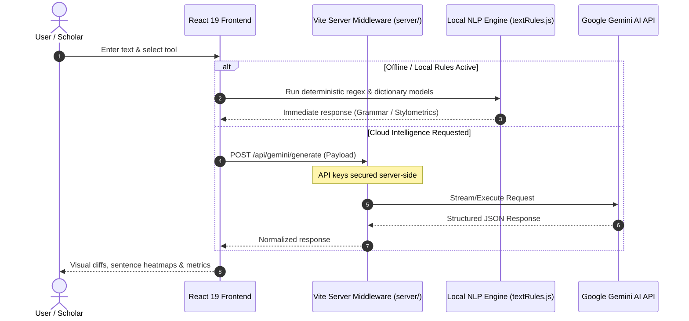

<p align="center">
  <picture>
    <source media="(prefers-color-scheme: dark)" srcset="public/logo-dark.png">
    <source media="(prefers-color-scheme: light)" srcset="public/logo-light.png">
    
  </picture>
</p>

<h1 align="center">Lexora AI Intelligence Suite</h1>

<p align="center">
  <strong>The Art of Better Words.</strong><br>
  A production-grade AI writing platform, multi-model neural text detector, academic unslop refiner, and empirical detector research laboratory.
</p>

<p align="center">
  <a href="https://github.com/SFRREX/lexora/blob/main/LICENSE"></a>
  <a href="https://react.dev/"></a>
  <a href="https://vite.dev/"></a>
  <a href="https://tailwindcss.com/"></a>
  <a href="https://oxc.rs/"></a>
  <a href="#-verification--automated-testing"></a>
  <a href="#-design-system--accessibility"></a>
</p>

<p align="center">
  <a href="#-about-lexora">About</a> •
  <a href="#-four-core-intelligence-modules">Core Modules</a> •
  <a href="#-architecture--data-flow">Architecture</a> •
  <a href="#-quickstart">Quickstart</a> •
  <a href="#-environment-configuration">Configuration</a> •
  <a href="#-verification--automated-testing">Testing</a> •
  <a href="#-github-repository-profile-settings">GitHub Details</a> •
  <a href="#-license--academic-attribution">License</a>
</p>

---

## 📖 About Lexora

**Lexora** is a research-grounded, production-minded AI writing and linguistic analysis suite. Rather than acting as a black-box text generator or an adversarial detector-bypass tool, Lexora provides transparent, verifiable, and ethical linguistic tools tailored for students, researchers, developers, and educators.

### Why Lexora?
* **Zero-Cost Accessibility:** Ships with a high-fidelity **Free Gemini Neural Detector** and a **100% Offline Local Stylometrics Engine**—no paid subscriptions or API paywalls required.
* **Transparent AI Detection:** Displays sentence-level perplexity heatmaps and cross-checks multi-provider agreement indices (Cohen's Kappa) rather than producing misleading binary scores.
* **Scholarly Integrity:** The Academic Refiner removes formulaic generative AI filler while enforcing strict, regex-backed protection for all citations (APA, MLA, IEEE, DOIs) and mathematical formulas.
* **Empirical Research Lab:** Features an interactive benchmarking environment to evaluate classifier metrics (Precision, Recall, ROC-AUC) against peer-reviewed linguistic research.

---

## 🌟 Four Core Intelligence Modules

```
┌─────────────────────────────────────────────────────────────────────────────┐
│                         LEXORA INTELLIGENCE SUITE                           │
├───────────────────┬───────────────────┬───────────────────┬─────────────────┤
│ ✍️ Writing Studio │  🛡️ AI Checker    │ 🎓 Academic       │ 🔬 Research Lab │
│                   │                   │    Refiner        │                 │
│ • 7 AI rewrite    │ • Free Gemini     │ • Nature-standard │ • ROC-AUC & F1  │
│   transformations │   Neural Detector │   unslop engine   │   metrics       │
│ • Contextual Word │ • Local offline   │ • 100% citation & │ • Labeled test  │
│   Enhancer        │   stylometrics    │   DOI safeguard   │   corpus        │
│ • Live visual diff│ • Sentence-level  │ • Decoupled,      │ • Robustness    │
│   markings        │   perplexity map  │   non-adversarial │   benchmarks    │
└───────────────────┴───────────────────┴───────────────────┴─────────────────┘
```

### 1. ✍️ Writing Studio (`#studio`)
* **7 Production Writing Tools:**
  * **Grammar & Spelling:** Corrects orthographic, grammatical, and typographical issues.
  * **Sentence Rephrase:** Reworks sentence structure for improved rhythm and flow.
  * **Fluency:** Refines non-native phrasing into natural, idiomatic expression.
  * **Shorten:** Eliminates wordiness and deadwood while retaining full semantic intent.
  * **Simplify:** Translates convoluted prose into clear, straightforward vocabulary.
  * **Professional Tone:** Polishes casual language into workplace-ready communication.
  * **Casual Tone:** Relaxes formal syntax into approachable, conversational dialogue.
* **Contextual Word Enhancer:** Instant synonym lookups categorized into *Professional*, *Casual*, *Stronger*, and *Simpler* registers.
* **Live Visual Diff Engine:** Highlights added words in slate-teal and struck-through deletions with character-level accuracy.

### 2. 🛡️ AI Text Checker (`#ai-checker`)
* **Dual Free Default Detectors:**
  * **Lexora Neural AI Detector (Free):** Leverages Google Gemini (`gemini-3.5-flash`, `gemini-3.5-flash-lite`, `gemini-3.8-flash`) for deep linguistic perplexity evaluation, sentence cadence analysis, and generative trope detection at zero cost.
  * **Lexora Local Stylometrics Engine (Free & Offline):** Pure JavaScript statistical NLP analyzer that evaluates sentence length variance (burstiness index), type-token lexical diversity (TTR), and n-gram uniformity with zero API keys required.
* **Sentence-Level Perplexity Heatmap:** Visual sentence cards color-coded by classification (*Human*, *Mixed*, *AI*) with detailed per-sentence hover analytics.
* **Multi-Provider Cross-Verification:** Supports commercial providers ([GPTZero](https://docs.gptzero.me/), [Copyleaks](https://docs.copyleaks.com/)) and calculates inter-detector agreement (Cohen's Kappa).
* **Scientific Disclosures:** Documents statistical limitations, minimum recommended sample size (&ge; 250 words), and non-native English false-positive caveats.

### 3. 🎓 Academic Refiner (`#academic-refiner`)
* **Nature-Standard Unslop Engine:** Systematically removes formulaic AI tropes (*"delve into"*, *"intricate tapestry"*, *"pivotal role"*, *"testament to"*, *"underscores the importance"*, *"sheds light on"*, *"groundbreaking"*).
* **Guaranteed Citation Protection:** Automated regex safeguards ensure 100% preservation of bracketed citations `[1, 2]`, author-year citations `(Smith et al., 2023)`, DOIs, empirical values, and statistical notations ($p < 0.05$, $R^2$).
* **Goal-Oriented Modes:** Custom refinement for *Academic Writing*, *Natural Writing*, *Grammar & Clarity*, or *Concise Writing* across *Conservative* and *Balanced* intensities.
* **Strict Non-Adversarial Architecture:** Explicitly decoupled from detector scores to prevent iterative adversarial exploitation.

### 4. 🔬 Detector Research Lab (`#detector-lab`)
* **Curated Evaluation Dataset:** Built-in benchmark corpus across human manuscripts, modern LLM generations, and mixed collaborative texts with provenance tracking.
* **Statistical Metrics Engine:** Calculates Precision (PPV), Recall (Sensitivity), Specificity (TNR), F1 Score, False Positive Rate (FPR), False Negative Rate (FNR), and ROC-AUC.
* **Threshold Calibration ($\tau$):** Real-time interactive decision threshold slider to observe trade-offs between false positives and false negatives.
* **Controlled Editing Robustness Tests:** Quantifies statistical score shifts before and after legitimate scholarly revision.
* **Peer-Reviewed Bibliography:** Summarizes findings from NAACL 2025, Cambridge University Press (*Data & Policy 2025*), Springer (*Acta Neurochirurgica 2025*), and OpenAI's classifier discontinuation notice.

---

## 🏗️ Architecture & Data Flow



### Key Architectural Tenets
1. **Zero Client-Side Secrets:** All external API requests are proxied through Vite server middleware (`server/vitePluginGemini.js`). API keys are never bundled into client JS.
2. **Resilient Rate-Limit & Caching Architecture:**
   * **Sliding-Window LRU Response Cache:** Memory-bounded LRU cache (capped at 200 items) eliminates duplicate API consumption and accelerates repetitive queries to sub-millisecond response times.
   * **In-Flight Request Deduplication:** Coalesces identical concurrent network queries into a single in-flight promise.
   * **Graceful 429 Rate-Limit Queue & Backoff:** Catches HTTP 429 quota exhaustion, serializes subsequent requests via an execution queue, and enforces automatic 20-second backoff so free-tier API keys degrade smoothly without failing user requests.
3. **Granular Span-Level Proofreading:**
   * Delivers minimal-span editorial corrections categorized into *Grammar*, *Spelling*, *Punctuation*, and *Style*.
   * Provides interactive chip overlays allowing users to review changes in context, filter by error type, and accept corrections individually or in batch.
4. **Four-Tier Granular Provenance Detection:**
   * Detects provenance across four distinct categories: `human-written`, `human-written & ai-refined`, `ai-generated & ai-refined`, and `ai-generated`.
   * Generates downloadable audit reports with forensic sentence-level perplexity, burstiness, and distribution statistics.
5. **Multi-Format Document Extraction:**
   * Direct in-browser upload and parsing for PDF documents (`pdfjs-dist`), raw text (`.txt`), and Markdown files (`.md`).
6. **Optimized Bundle Splitting:**
   * Asynchronous route-level code-splitting (`React.lazy` + `Suspense`) maintains initial bundles below 470 kB with zero Vite chunk size warnings.
7. **Deterministic Offline Fallbacks:** Fast local dictionary and regex rules (`src/utils/textRules.js`, `server/detectors/localStylometrics.js`) guarantee core functionality even in air-gapped environments.
8. **Pure React 19 + JSX:** Optimized for performance and simplicity with zero TypeScript build overhead.

---

## 🎨 Design System & Accessibility

Lexora features a bespoke design system calibrated directly to its brand mark:

| Role | Token / Hex | Description |
| :--- | :--- | :--- |
| **Dark Base Canvas** | `#0f1115` | Deep Obsidian Slate canvas (from official logo background) |
| **Dark Card Surfaces** | `#14171f`, `#151820` | Elevated architectural card surfaces |
| **Light Base Canvas** | `#f8fafc` | Clean, crisp slate paper surface |
| **Architectural Borders**| `#222734`, `#282f3d` | High-contrast divider lines |
| **Primary Accent** | `#38858a` (hover `#2c6e73`)| Nordic Slate-Teal (matching the faceted pen nib) |
| **Highlight & Focus** | `#4fa3a8` | Glacial Cyan focus rings and interactive states |
| **Typography** | `Inter` & `Outfit` | Clean sans-serif pairings with -0.025em letter tracking |

### Accessibility Highlights
* **WCAG 2.2 AA Compliance:** Contrast ratios exceed 4.5:1 for normal text and 3:1 for large text.
* **Focus Visible:** Distinctive `focus-visible:ring-2 focus-visible:ring-[#4fa3a8]` rings on all interactive elements.
* **Motion Accessibility:** Automatically respects `prefers-reduced-motion: reduce` via media query overrides.
* **Anti-FOUT Theme Sync:** Inline synchronous `<script>` in `<head>` ensures zero Flash of Unstyled Theme during initial page load.

---

## 📂 Project Directory Structure

```text
lexora/
├── public/                       # Static public assets
│   ├── logo-light.png            # Official light-theme brand logo
│   ├── logo-dark.png             # Official dark-theme brand logo
│   ├── icon-light.png            # Light-theme emblem (300x300)
│   ├── icon-dark.png             # Dark-theme emblem (300x300)
│   ├── favicon-light.png         # Browser favicon (light mode)
│   └── favicon-dark.png          # Browser favicon (dark mode)
├── server/                       # Server-side proxy & detection adapters
│   ├── academicRefinerService.js # Nature-standard unslop & citation engine
│   ├── geminiService.js          # Google Gemini integration & multi-model fallback
│   ├── vitePluginGemini.js       # Vite development proxy middleware
│   └── detectors/                # Modular detector adapters
│       ├── gptzero.js            # GPTZero API integration
│       ├── copyleaks.js          # Copyleaks API integration
│       └── localStylometrics.js  # Offline statistical NLP analyzer
├── src/                          # React 19 Frontend application
│   ├── components/               # Modular UI components
│   │   ├── Navbar.jsx            # Sticky navigation & adaptive theme switch
│   │   ├── Hero.jsx              # Landing hero & quick-start input
│   │   ├── WritingEditor.jsx     # Main studio editor with 7 AI tools
│   │   ├── WordEnhancer.jsx      # Contextual synonym finder
│   │   ├── AIChecker.jsx         # Multi-model AI detection suite
│   │   ├── AcademicRefiner.jsx   # Scholarly unslop & citation safeguard
│   │   ├── DetectorResearchLab.jsx # Empirical classifier benchmark suite
│   │   ├── ResultPanel.jsx       # Visual diff & output rendering
│   │   ├── ToolSelector.jsx      # Segmented tool switching pill
│   │   └── FinalCTA.jsx          # Conversion callout with brand emblem
│   ├── utils/                    # Frontend utilities & dataset specs
│   │   ├── textRules.js          # Offline regex grammar & tone engine
│   │   ├── researchDataset.js    # Curated benchmark documents & literature
│   │   └── researchMetrics.js    # Classification statistics (ROC-AUC, F1, Kappa)
│   ├── App.jsx                   # Primary app router & state coordinator
│   ├── index.css                 # Tailwind CSS v4 design tokens & base rules
│   └── main.jsx                  # Application DOM entry point
├── test-suite.js                 # Automated suite verification tests
├── test-rules.js                 # Unit tests for text rules & regex transformations
├── index.html                    # Root HTML template with theme bootstrapping
├── vite.config.js                # Vite 8 build & server plugin configuration
├── package.json                  # Dependencies, scripts, and package metadata
├── LICENSE                       # Open-source MIT License
└── README.md                     # Project documentation & GitHub guide
```

---

## 🚀 Quickstart

### Prerequisites
* **Node.js:** v18.0.0 or higher (v20+ recommended)
* **npm:** v9.0.0 or higher

### Installation

```bash
# 1. Clone the repository
git clone https://github.com/SFRREX/lexora.git
cd lexora

# 2. Install dependencies
npm install
```

### Environment Configuration

Create your `.env` file by copying `.env.example`:

```bash
cp .env.example .env
```

Open `.env` in your editor:

```env
# Google Gemini API Key (100% Free at https://aistudio.google.com/)
GEMINI_API_KEY=your_gemini_api_key_here

# Optional Commercial Detectors (Leave blank to use Free Default Detectors)
GPTZERO_API_KEY=
COPYLEAKS_EMAIL=
COPYLEAKS_API_KEY=
```

> **Note:** Lexora functions **100% out of the box** even without any API keys by automatically utilizing its built-in Local Rules Engine and Local Stylometrics NLP analyzer.

### Development Server

```bash
npm run dev
```

Open [http://localhost:5173](http://localhost:5173) in your browser.

---

## 🧪 Verification & Automated Testing

Lexora features a comprehensive, dual-tiered test harness covering component behavior, adapter normalization, offline statistical routines, and build integrity:

```bash
# Run full Vitest unit & component test suite (54 tests across 6 files)
npm test

# Run Vitest in interactive watch mode
npm run test:watch

# Generate code coverage report via v8 engine
npm run test:coverage

# Run integration & adapter verification suites
npm run test:suite

# Run Oxlint high-performance code linter
npm run lint

# Compile optimized production bundle
npm run build

# Run complete unified quality gate (lint + tests + integration + build)
npm run check
```

### Test Coverage Highlights
* **Adapter Normalization:** Validates response formatting for GPTZero, Copyleaks, Local Stylometrics, and Gemini Neural Detector.
* **Inter-Detector Agreement:** Verifies Cohen's Kappa calculation and agreement categorization.
* **Statistical Metrics:** Confirms accuracy of Precision, Recall, Specificity, F1, and ROC-AUC formulas.
* **Citation Preservation & Unslop:** Rigorously verifies preservation of bracketed citations, DOIs, and statistical notations during academic refinement.
* **Four-Tier Provenance Classification:** Verifies granular sentence provenance distribution across 4 discrete tiers.
* **LRU Caching & Eviction:** Validates sliding-window cache hit/miss behavior and strict 200-item eviction.
* **429 Rate-Limit Queue:** Verifies serialized promise queuing and backoff delays upon quota limits.
* **Span-Level Grammar Corrections:** Verifies substring index localization and non-overlapping span filtering.
* **Grammar & Tone Rules:** Unit tests offline transformations across grammar, simplification, and tone registers.

---

## 🌐 GitHub Repository Profile Settings

For maintainers publishing or updating this project on GitHub, use the following configuration in the repository **About** section (top right of your GitHub repository page):

| Field | Recommended Value |
| :--- | :--- |
| **Repository Name** | `lexora` |
| **Description** | `⚡ The Art of Better Words. Production-grade AI writing suite, neural text detection, academic unslop, and empirical detector research lab built with React 19, Vite 8, and Tailwind CSS v4.` |
| **Website** | `https://github.com/SFRREX/lexora` *(or your deployed production URL)* |
| **Include in Home** | ✅ Releases, ✅ Packages, ✅ Environments |
| **Topics / Tags** | `ai-writing`, `ai-detection`, `react19`, `vite`, `tailwindcss-v4`, `nlp`, `academic-writing`, `gemini-api`, `stylometrics`, `perplexity`, `burstiness`, `research-benchmarking`, `unslop`, `grammar-correction` |

---

## 🔒 Responsible AI & Ethical Disclosure

1. **Probabilistic Limitations:** Statistical and neural AI detectors output probability estimates, not definitive proof of authorship. Scores should inform human editorial review rather than serve as sole arbiters.
2. **Non-Native Linguistic Bias:** Consistent with published findings in NAACL and Springer, non-native English writing may exhibit lower burstiness. Lexora explicitly surfaces methodological caveats on small samples and provides educational guidance to prevent unfair penalization.
3. **Privacy First:** User inputs are processed in-memory during active sessions and are never stored, logged, or shared with third parties.

---

## 📄 License & Academic Attribution

This project is open-source software licensed under the [MIT License](LICENSE).

If you use Lexora in academic research or linguistic benchmarking, please cite:

```bibtex
@software{lexora2026,
  author = {Razedus Safar and Contributors},
  title = {Lexora AI Intelligence Suite: Production Writing, Neural Detection, and Academic Refinement},
  year = {2026},
  url = {https://github.com/SFRREX/lexora}
}
```

<p align="center">
  Built with care by <a href="https://github.com/SFRREX">Razedus Safar</a> • Lexora Intelligence Suite
</p>
